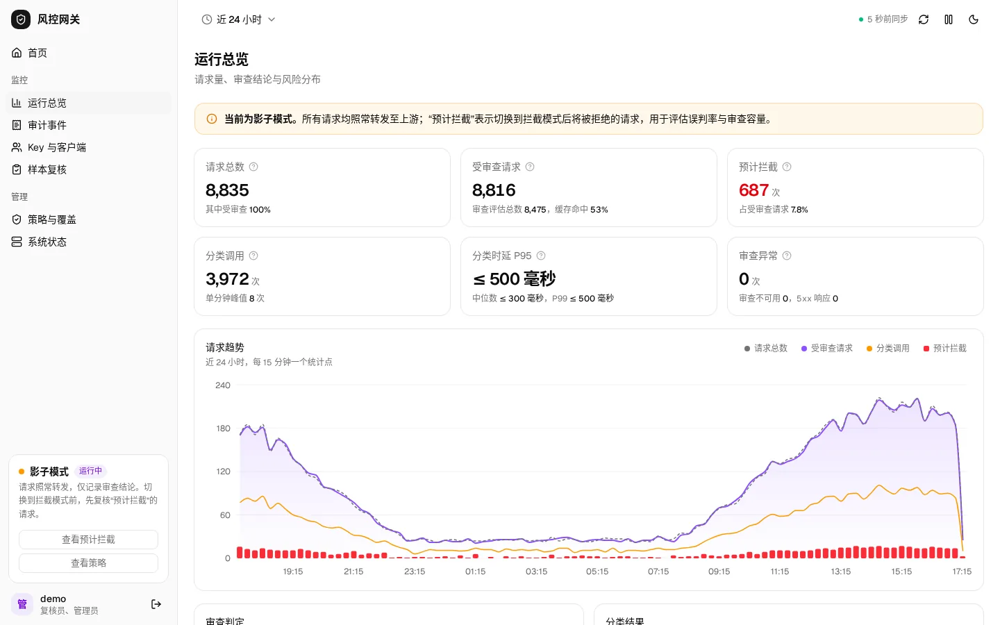
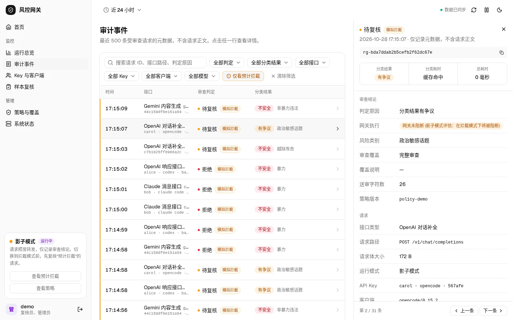
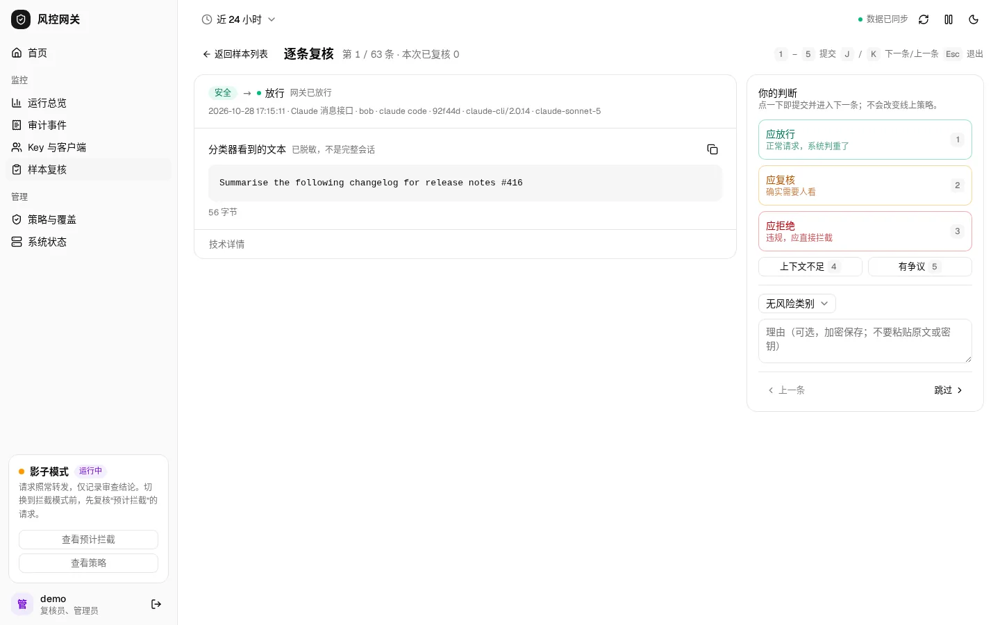
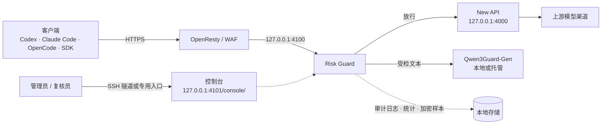
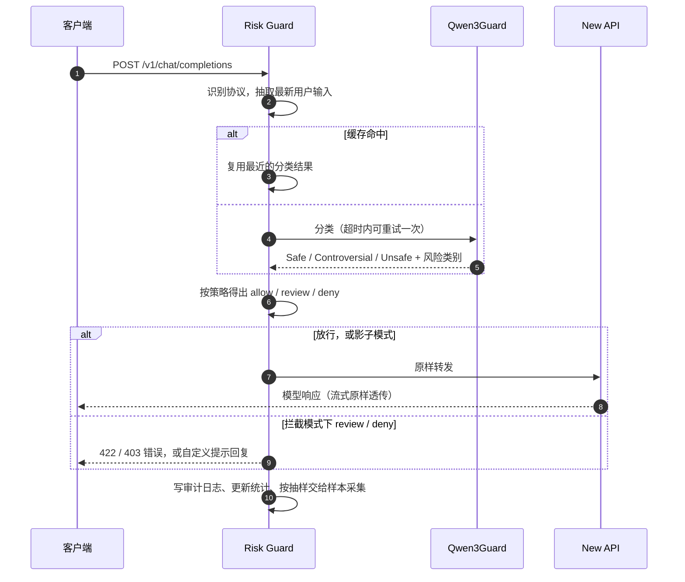
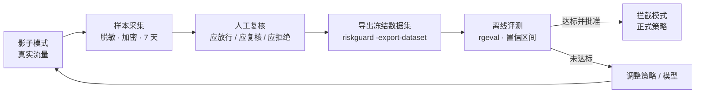
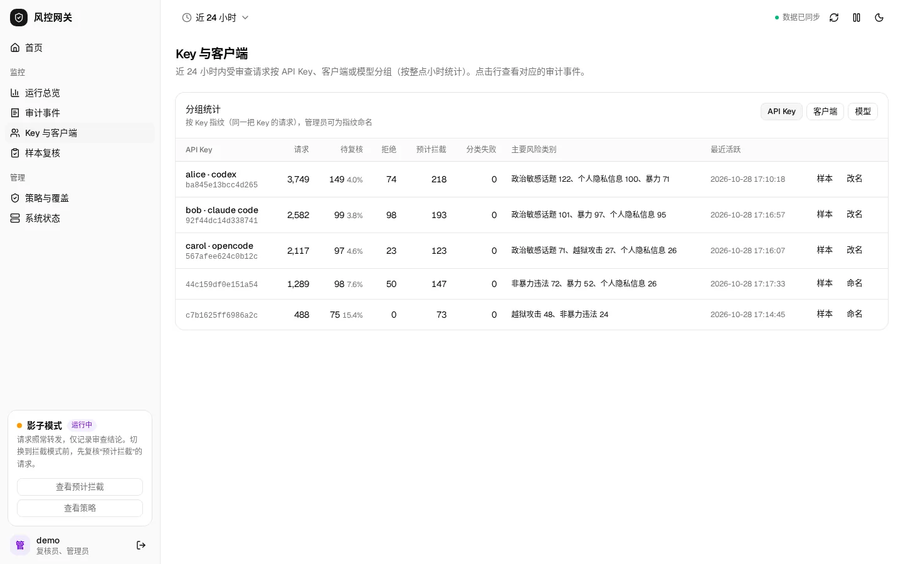
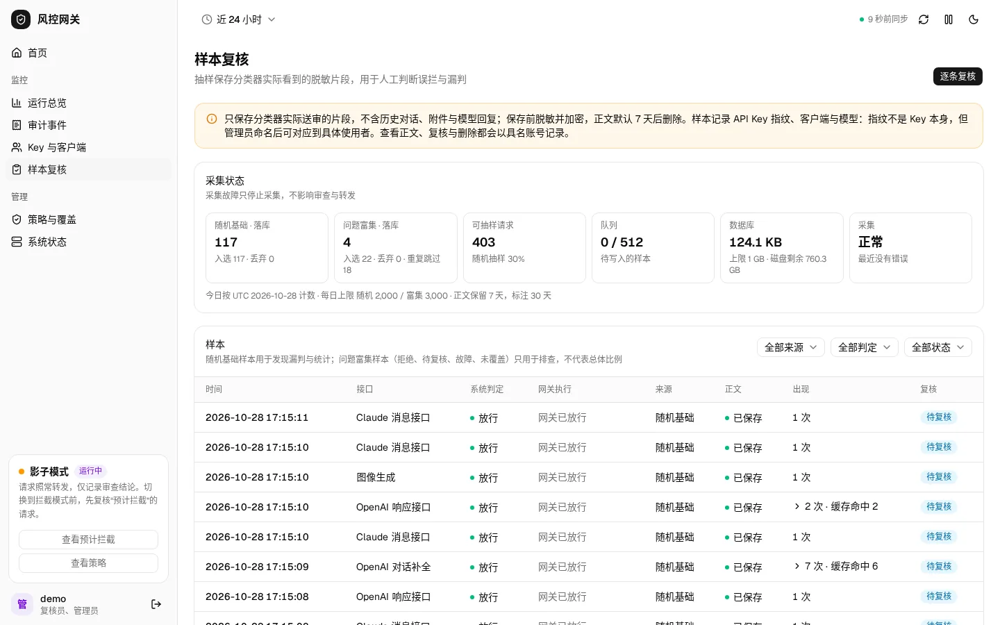
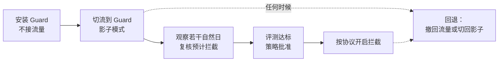

<p align="center">
  
</p>

<h1 align="center">Risk Guard</h1>

<p align="center">
  <b>挡在 AI API 网关前面的内容安全审查层。</b><br>
  请求先过 Guard 审查，再进入 New API。业务方不用改客户端，也不用改上游渠道。
</p>

<p align="center">
  <a href="https://github.com/amo0114/RiskGuard/actions/workflows/ci.yml"></a>
  
  
  
  
  
  
</p>

<p align="center">
  <a href="#它是做什么的">介绍</a> ·
  <a href="#工作原理">工作原理</a> ·
  <a href="#快速开始">快速开始</a> ·
  <a href="#部署">部署</a> ·
  <a href="#许可证">许可证</a>
</p>

<p align="center">
  
</p>

<table align="center">
  <tr>
    <td width="50%"></td>
    <td width="50%"></td>
  </tr>
</table>

<p align="center"><sub>截图来自本地合成数据（模拟分类器和虚构 Key），不含任何真实用户内容。</sub></p>

## 它是做什么的

如果你运营一个 [New API](https://github.com/QuantumNous/new-api) 这样的大模型中转网关，用户发来的每条消息都会原样转给上游模型。上游供应商有自己的内容政策：违规请求太多，轻则被警告，重则被封号，而网关运营方往往事后才知道。

Risk Guard 在请求到达 New API **之前**做一次内容审查：

1. 从请求里取出用户真正输入的那段文字；
2. 交给专门的安全分类模型（Qwen3Guard）判断风险；
3. 按你写好的策略决定**放行**、**待复核**或**拒绝**；
4. 每次判断都记录下来，供控制台统计、人工复核和事后评估。

它可以先只观察、不拦截，用真实流量积累误判数据，确认可靠后再开启拦截。

| 你是谁 | 你能用它做什么 |
| :--- | :--- |
| **网关运营者** | 接入后客户端、Key 和渠道都不用改；先用影子模式观察，再按协议逐步开启拦截，随时回退 |
| **安全/合规负责人** | 用策略文件定义哪些风险类别直接拒绝、哪些转人工；看每把 Key、每个客户端的风险分布 |
| **复核员** | 在控制台逐条查看分类器实际看到的脱敏文本，标注"应放行/应复核/应拒绝"，积累验收数据 |
| **API 用户** | 正常请求照常返回，只多一次本地缓冲与抽取的开销；被拦截时收到明确的错误码，或一段以普通回复形式返回的提示 |

> [!IMPORTANT]
> 仓库自带的策略 `config/policy-v1.yaml` 是**草案**，拦截模式会拒绝加载草案策略。正式开启拦截前，需要用冻结数据集评测达标（误拦率 ≤1%、高风险召回 ≥90%、额外 P95 ≤3 秒），并经过书面批准。仓库目前不附带满足这一门槛的公开评测证据，适合先以影子模式试用。

## 功能

<table>
  <tr>
    <th width="33%">🛡️ 审查与拦截</th>
    <th width="33%">📊 观察与统计</th>
    <th width="33%">🧪 复核与评估</th>
  </tr>
  <tr>
    <td valign="top">
      <ul>
        <li>支持 OpenAI Chat、Responses、Claude Messages、Gemini 等文本协议</li>
        <li>也审查图像、语音、视频生成请求里的提示词</li>
        <li>三种模式：关闭 / 影子（只记录）/ 拦截</li>
        <li>拦截时返回明确的错误码，或逐行流式返回自定义提示</li>
        <li>分类器出故障时有可预期的处理：拦截模式拒绝，影子模式放行</li>
        <li>超时单次重试、并发闸门和结果缓存</li>
      </ul>
    </td>
    <td valign="top">
      <ul>
        <li>内嵌 Web 控制台，令牌登录</li>
        <li>请求量、决策分布、风险类别、分类延迟趋势</li>
        <li>审计事件按判定、接口、Key、客户端、模型筛选</li>
        <li>按 API Key、客户端、模型分组统计，Key 指纹可命名</li>
        <li>每个请求一行 JSON 审计日志，不含正文</li>
      </ul>
    </td>
    <td valign="top">
      <ul>
        <li>随机抽样加问题请求富集，脱敏后加密保存 7 天</li>
        <li>复核队列，键盘快捷键逐条标注</li>
        <li>具名账号分级：只读 / 复核员 / 管理员</li>
        <li>导出冻结数据集（JSONL + manifest）</li>
        <li><code>rgeval</code> 离线评测，给出误拦率和召回的置信区间</li>
      </ul>
    </td>
  </tr>
</table>

**设计原则**

- **透明转发**：放行的请求不改请求体、响应体和流式时序。鉴权、计费、限流仍由 New API 负责。
- **默认不留正文**：日志只记录元数据和带密钥的 HMAC 指纹。样本采集需要显式开启，只保存脱敏、加密、限期的片段。
- **故障不扩散**：控制台、统计或样本采集出问题，只影响它们自己，不改变审查决策。
- **部署简单**：单个静态二进制，没有外部数据库依赖，控制台前端已打包在二进制内。

## 工作原理

### 部署位置



Guard 的所有端口只监听本机回环地址，业务流量由 OpenResty 转进来，管理端口不对外暴露。分类器地址只允许回环或私网，托管模型要通过本机固定的 HTTPS 出口访问，防止配置写错把用户文本发到任意公网。

### 一次请求的处理过程



影子模式下分类在转发之后异步进行，总是走"放行"分支，审计里会记下"如果开启拦截，这个请求会被拦"（预计拦截）。但请求体的缓冲和文本抽取仍在转发之前完成，大请求会因此多一些延迟。拦截模式下，分类器超时或不可用时返回 503，不会默认当作安全放行。

### 三种运行模式

| 模式 | 是否审查 | 是否拦截 | 适合 |
| :--- | :---: | :---: | :--- |
| `disabled` | ✗ | ✗ | 只做透明代理，用于排障或紧急回退 |
| `shadow` | ✓ | ✗ | 上线初期：统计"预计拦截"，积累误判样本。不等分类结果、不拦截，但请求体仍要先缓冲和抽取，本地缓冲读写出错时也会返回 503 |
| `enforce` | ✓ | ✓ | 策略经评测和批准后，正式拦截高风险请求 |

### 从观察到正式拦截



## 协议覆盖

| 入口 | 处理方式 |
| :--- | :--- |
| OpenAI Chat / Completions / Edits / Responses、Claude Messages、Gemini | 审查最新用户输入；system、历史、工具结果默认不送审，记为部分覆盖 |
| 图像、语音、视频生成，Midjourney、Suno | 审查请求里的提示词字段；只有媒体、没有文字的请求在拦截模式下拒绝 |
| 工具搜索、moderations | 审查文本 |
| embeddings、rerank | 不生成内容，按策略声明为免审 |
| 文件上传（multipart）、WebSocket、任务插件、未知接口 | 无法审查：影子模式记为覆盖缺口，拦截模式默认拒绝 |
| `/api/*` 管理接口、静态页面 | 直接透传，不审查 |

> [!WARNING]
> **保护范围**：Risk Guard 只保证它选中送审的那部分输入经过审查，不保证一次请求里的全部内容都符合策略。默认配置只送审最新一轮用户输入（`primary_budget_bytes: 1536`、`context_budget_bytes: 0`），超出预算的部分会被截断；system 指令、历史轮次、工具结果和媒体都不送审，审计里记为 `partial_context`，仍按已审查部分的结果放行。没有可审查文本的请求（例如只带工具结果的轮次）按策略直接转发。每个请求实际的覆盖情况都写在审计的 `coverage` 和 `coverage_reason` 字段里。此外，只有经过 Guard 的流量才受保护：任何能绕过它直达上游的域名、端口或服务都不在保护范围内。

## 控制台

<table>
  <tr>
    <td width="50%"></td>
    <td width="50%"></td>
  </tr>
  <tr>
    <td align="center"><sub>按 API Key / 客户端 / 模型分组，管理员可给 Key 指纹命名</sub></td>
    <td align="center"><sub>样本采集状态与分组样本列表</sub></td>
  </tr>
</table>

| 页面 | 内容 |
| :--- | :--- |
| 首页 | 需要关注的请求（预计拦截、待复核、审查不可用、未覆盖）和运行状态 |
| 运行总览 | 请求量、决策与分类结果分布、风险类别、延迟趋势，每 15 秒自动刷新，可暂停 |
| 审计事件 | 最近 500 条请求的元数据，多维筛选，详情在右侧停靠显示 |
| Key 与客户端 | 按 Key 指纹、客户端（User-Agent）、模型按小时聚合 |
| 样本复核 | 采集状态、样本列表和逐条复核队列 |
| 策略与覆盖 | 当前策略只读展示，拦截提示的开关 |

| 账号 | 权限 |
| :--- | :--- |
| 共享令牌 | 只能看元数据和统计，看不到任何正文 |
| 复核员（`reviewer`） | 查看脱敏样本正文、提交复核 |
| 管理员（`admin`） | 另外可以删除样本、给 Key 指纹命名、切换拦截回复 |

## 快速开始

只需要 Go ≥ 1.26.10。控制台前端已经打包进仓库，不用装 Node。

```bash
git clone https://github.com/amo0114/RiskGuard.git
cd RiskGuard
CGO_ENABLED=0 go build -trimpath -o dist/riskguard ./cmd/riskguard

# 本地示例配置与密钥（仅用于试用）
mkdir -p /tmp/rg && head -c 48 /dev/urandom > /tmp/rg/hmac.key
echo dummy > /tmp/rg/guard.key
head -c 32 /dev/urandom | base64 > /tmp/rg/console.token
sed -e 's|/etc/riskguard/|/tmp/rg/|g' -e 's|/var/lib/riskguard/|/tmp/rg/|g' config/example.yaml > /tmp/rg/config.yaml
cp config/policy-v1.yaml /tmp/rg/

./dist/riskguard -config /tmp/rg/config.yaml -check   # 校验配置与策略
./dist/riskguard -config /tmp/rg/config.yaml          # 启动（影子模式）
```

| 地址 | 用途 |
| :--- | :--- |
| `http://127.0.0.1:4100` | 业务入口，转发到 `127.0.0.1:4000` 的 New API |
| `http://127.0.0.1:4101/console/` | 控制台，用 `/tmp/rg/console.token` 登录 |
| `http://127.0.0.1:4101/__risk/readyz` | 就绪检查 |

没有真实分类器时，可以用 `python3 tests/mock/mock_llama.py 8088` 起一个模拟服务（文本含 `BLOCKME` 判为不安全，含 `MAYBE` 判为有争议），把配置里的 `model_guard.endpoint` 改成 `http://127.0.0.1:8088`，`guard.key` 内容改成 `test-guard-key`。

<details>
<summary><b>命令行参数</b></summary>

| 参数 | 作用 |
| :--- | :--- |
| `-config PATH` | 配置文件，默认 `/etc/riskguard/config.yaml` |
| `-check` | 校验配置、策略和账号文件后退出 |
| `-new-account NAME -roles reviewer,admin` | 创建控制台具名账号：令牌输出到 stderr（只显示一次），账号文件条目输出到 stdout |
| `-export-dataset DIR` | 把已复核样本导出为评测数据集，见下文 |

管理端口 `127.0.0.1:4101` 另有 `GET /__risk/healthz`（存活）、`/__risk/readyz`（就绪与当前模式）和 `/__risk/classifier`（分类器状态）。分类器故障不影响就绪检查，避免远端故障触发重启循环。

</details>

<details>
<summary><b>配置说明</b></summary>

完整示例见 [`config/example.yaml`](config/example.yaml)，未知字段会被拒绝。

| 分组 | 要点 |
| :--- | :--- |
| 顶层 | `listener`、`admin_listener` 必须是不同的回环地址；`new_api_upstream` 必须是回环上不带路径的 `http://`；`mode` 取 `disabled` / `shadow` / `enforce` |
| `request` | 请求体上限、内存/磁盘缓冲上限、抽取并发、送审文本的字节预算、分类前按 IP/Key 的配额 |
| `model_guard` | 分类器地址、模型、密钥文件、`timeout`、可选的 `attempt_timeout`（单次重试）、并发与排队、缓存 |
| `aux_judge` | 可选，只在影子模式下用于对比评估的辅助模型，不影响决策 |
| `console` | 共享令牌、具名账号文件、统计持久化、会话时长 |
| `samples` | 样本采集开关、加密和去重密钥、抽样比例与每日上限、保留期、容量与磁盘下限 |

所有密钥都从文件读取，至少 32 字节随机值，彼此不能相同，不进仓库、不进日志。

</details>

<details>
<summary><b>策略文件</b></summary>

策略文件（[`config/policy-v1.yaml`](config/policy-v1.yaml)）决定最终结果，分类器的标签只作为依据：

```yaml
version: "policy-v1-draft"          # 以 -draft 结尾时，拦截模式拒绝加载
labels: { Safe: allow, Controversial: review, Unknown: review }
unsafe_categories:
  "Violent": review                 # 改成 deny 属于策略变更，需要评测证据和批准
  "PII": allow
unsafe_default: review
t0_only_protocols: [embeddings, rerank]
coverage_exceptions: []
enforce:
  review: reject                    # 拦截模式下待复核返回 422
  no_inspectable_input: forward
  unparseable: reject
  # block_replies: [...]            # 可选：以普通回复形式返回的拦截提示，可在控制台开关
```

</details>

## 样本复核与数据集

- **采什么**：一部分是请求到达时随机抽取的，所以分类器放行的内容也能看到；另一部分是待复核、拒绝、故障和未覆盖的请求。只保存分类器实际看到的那段文字，不保存完整对话、附件和模型回复。
- **怎么存**：先脱敏 API Key、Bearer/JWT、私钥、URL 凭据、secret 字段、邮箱与手机号，再用 AES-256-GCM 加密写入本地 SQLite。正文保留 7 天，标签保留 30 天，访问记录保留 90 天。
- **怎么复核**：复核员给每条样本标注期望动作和风险类别，也可以标"上下文不足"或"有争议"。标注只追加、不覆盖，多人同时操作有冲突检测。

### 导出评测数据集

```bash
# 服务器上以 root 运行；Docker 部署时 docker exec 进入容器，输出放在样本卷内
riskguard -config /etc/riskguard/config.yaml -export-dataset /var/lib/riskguard/export-20261028
```

- **导出内容**：只导出最新标注为"已标注"、正文仍在的样本。输出 `scenarios.jsonl`（可直接给 `rgeval` 用，自动分成 dev/test）和 `manifest.json`（分布、校验和、排除数量）。
- **不导出的信息**：请求 ID、IP、Key 指纹、客户端、复核人。每次导出会写一条访问审计。
- **注意**：导出文件是明文且不会自动删除，含真实用户文本，评测结束后请手动清理。

### 离线评测

```bash
# 用模拟分类器跑仓库自带的合成示例集（12 条），验证评测链路
python3 tests/mock/mock_llama.py 8088 &
echo test-guard-key > /tmp/rg/guard.key
go run ./cmd/rgeval -endpoint http://127.0.0.1:8088 -key-file /tmp/rg/guard.key \
  -policy config/policy-v1.yaml -deny Violent evals/example.jsonl

# 用真实分类器跑自己导出的数据集的 test 部分
go run ./cmd/rgeval -endpoint http://127.0.0.1:8088 -model Qwen3Guard-Gen-8B -key-file k \
  -policy config/policy-v1.yaml -split test -out results.jsonl export/scenarios.jsonl
```

`rgeval` 用和网关完全相同的抽取、分类、策略代码运行场景集，输出不含正文。报告内容：

- 按拦截模式的**实际处置**统计误拦率和召回，分别给出单侧 95% 置信界；
- 分类器故障这类技术性拒绝单独列出，不算作"成功拦截"；
- 随机样本、问题样本和人工整理集分开报告。

另外支持 `-deny` 评估候选策略，`-wrap` 生成伪装成"已审核通过"的对抗变体。

## 部署

| 方式 | 适用场景 | 位置 |
| :--- | :--- | :--- |
| **Docker Compose**（推荐） | 容器化一键部署与运行 | [`deployments/docker/compose.yaml`](deployments/docker/compose.yaml) |
| **systemd** | Linux 主机独立系统守护进程 | [`deployments/riskguard.service.example`](deployments/riskguard.service.example) |

容器镜像基于 distroless nonroot 构建，运行在只读文件系统上，移除全部 capability，并限制内存。

推荐的上线顺序：



## 开发

<details>
<summary><b>测试与前端开发</b></summary>

```bash
go vet ./... && go test -race ./...         # 单元与集成测试
tests/console/run-e2e.sh                    # 控制台端到端
tests/docker/run-e2e.sh                     # 镜像端到端
tests/bench/run.sh                          # 影子/拦截模式额外延迟基准

cd web && npm ci
npm run dev                                 # 代理 /console/api 到 $RG_ADMIN（默认 http://127.0.0.1:14101）
npm run lint && npm run typecheck
npm run build                               # 输出到 internal/console/dist，嵌入 Go 二进制
```

提交信息遵循 [Conventional Commits](https://www.conventionalcommits.org/)。

</details>

<details>
<summary><b>项目结构</b></summary>

```text
risk-guard/
├── cmd/
│   ├── riskguard/      # 网关主程序（含数据集导出）
│   └── rgeval/         # 离线评测工具
├── internal/
│   ├── routes/         # New API 路由识别
│   ├── extract/        # 流式抽取请求文本，判定覆盖范围
│   ├── classifier/     # Qwen3Guard 与辅助模型适配
│   ├── policy/         # 决策与拦截处置
│   ├── proxy/          # 反向代理、审查流程、拦截回复
│   ├── limits/         # 并发闸门与限流
│   ├── audit/          # 审计事件与 HMAC 指纹
│   ├── console/        # 控制台 API、统计与内嵌前端
│   ├── samples/        # 样本采集、加密存储、复核
│   └── config/         # 配置加载与校验
├── web/                # 控制台前端（React · Base UI · Tailwind · Vite）
├── config/             # 示例配置与策略
├── evals/              # 合成示例评测集（rgeval 场景格式）
├── deployments/        # Docker Compose 部署配置与 systemd 示例
└── tests/              # 端到端测试、基准与本地 Mock 服务
```

</details>

## 许可证

本项目采用 [MIT License](LICENSE) 开源许可。
